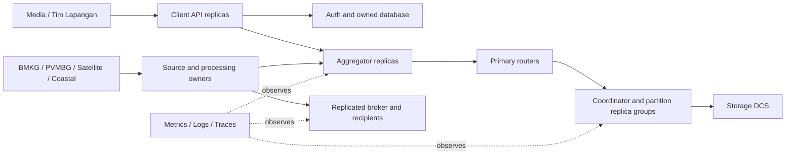

# Platform integration handoff

The platform implementation is ready for teammate review and deferred execution.
It is not a completed HA deployment or project acceptance result. The local four
QEMU/KVM VMs stay stopped during development, and no new builds/tests were run for
these subsections. Both assignment specification Markdown files remain excluded
from commits; normal documentation is included.

## Delivered code and owner boundaries

| Platform subsection | Integration entry | Owner work still required |
| --- | --- | --- |
| Synchronous local storage and source election | `platform-storage.py`, `platform-aggregator.py` | Real image digests, actual bootstrap identities, migration, HA/freeze/disk-loss proofs |
| Processor authority and audit coordination | [Processor/audit contract](Platform-Processor-and-Audit-Handoff.md) | Teammate pins/copies/completeness/HTTP/processor transaction integration |
| Shared services and retained volumes | `platform-services.py`, service catalog | Registry/Auth/consumer database HA, source HA, messaging acknowledgements and new owner services |
| Fenced empty-node replacement | [Replacement runbook](Platform-Replacement-Runbook.md) | Owner-specific broker/source/database recovery hooks; execution/failure-phase validation |
| Explicit storage/network isolation | `platform-isolation.py` | Actual required/forbidden connectivity and Tester Agent compatibility proof |
| Metrics/logs/traces and resources | [Observability handoff](Platform-Observability-Handoff.md) | Image startup validation, owner SLIs, per-broker collection, durable monitoring if required |
| Field request reservation | [Overload handoff](Platform-Overload-Handoff.md) | End-to-end Auth/read/source/critical-delivery capacity isolation and evidence |
| Sustained load, scaling, rollout and fault evidence | [Game-day runbook](Platform-Game-Day-Runbook.md) | Owner fixtures, original-identity delivery/canonical reconciliation, adequate load hardware |
| Dependency assembly and budget report | `platform-deploy.py` | Prepared private artifacts, live resource review, acceptance and final tuning |

## Prepare and deploy later

Copy `deployment/platform/bundle.example.json` to a private working directory.
Paths resolve relative to that copy. Populate its artifacts with outputs from
the storage, service, Aggregator, isolation and monitoring renderers, plus the
teammates' owner-database and processing artifacts. Do not combine duplicate
Namespace/Service/ConfigMap objects across stages. Preserve the exact namespace,
role budgets, immutable images and component ownership labels.

The bundle deliberately lists unresolved prerequisites. Resolve the actual work
before removing each item: this is a review checklist, not an assertion that
setting a flag establishes durability. In particular, canonical migration is an
explicit administrator operation while **all writers/publishers are stopped**
and distributed recovery has settled. Runtime startup does not migrate schemas.
The prepared deployment command does not bootstrap storage, discover physical
system IDs, run migrations, build images or provision VMs implicitly.

```sh
# Offline: reads prepared files, reports missing artifacts and memory blockers.
python3 scripts/platform-deploy.py plan --bundle /private/bundle.json \
  --output /private/deployment-plan.json

# Later: after starting/validating the already-owned cluster, prepare only the
# exact service/monitoring paths from their rendered requirements files.
python3 scripts/platform-deploy.py prepare-volumes \
  --requirements /private/services/requirements.json \
  --requirements /private/monitoring/requirements.json

# One command applies the prepared application bundle in dependency order.
python3 scripts/platform-deploy.py apply --bundle /private/bundle.json
```

Canonical storage volumes use their existing `platform-storage.py prepare-disks`
workflow. Service/monitoring preparation checks the guest ownership marker,
mounted data disk, expected directory root, marker and UID before creating empty
paths. It refuses to adopt unmarked existing data or change existing ownership.
It never deletes data or starts a VM.

The planner rejects mutable workload images, wrong namespaces/ownership,
assignment memory-budget mismatches, duplicate resources and dependency cycles.
It inventories required Secret references without printing their values. Secrets
provided in private bundle artifacts can be applied; other referenced Secrets
must already exist before application. Keep every private artifact under an
ignored or external directory and keep application credentials out of ConfigMaps.

Stages can declare targeted workload waits. Wait for databases/broker setup before
dependent jobs where necessary. Avoid waiting for Client API before Aggregator is
created; Client API's readiness depends on it. A final pass waits for all bundle
workloads. Application `apply` stops on failure and leaves applied resources for
inspection; there is no destructive automatic rollback.

## Capacity and later verification

The default 512 MiB/node guest/Kubernetes reserve is a planning estimate. The
offline report includes replicated workload requests, daemon copies, fixed-node
requests and init-container maximums; owner restartable-init sidecars require
explicit accounting first. It is a lower-bound check, not a scheduler or measured
fit guarantee. It omits rollout surge, physical-host failures, CPU/disk/IOPS,
ephemeral disk, distribution of flexible pods and full recovery headroom.

`apply` also requires all four existing nodes Ready and checks aggregate live
allocatable memory against requests and other scheduled workload reservations.
Missing resource requests and actual system working sets require separate review.
The full 15-PostgreSQL Citus topology alone reserves 7.5 GiB before DCS, routers,
applications and monitoring, so it cannot fit the current 7 GiB VM allocation.
Use selected components for development, then resize/move acceptance later.

After both teammates finish, review the contracts together, supply their missing
artifacts, run the deferred checks on suitable hardware, fix integration failures,
and tune requests/limits/capacity from measurements. Keep every unexecuted or
failed acceptance row pending. The game-day result must include the original
critical-operation denominator, actual receipts and gaps, not merely healthy pods.


